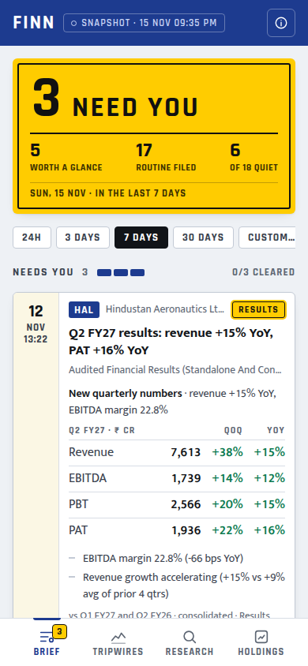
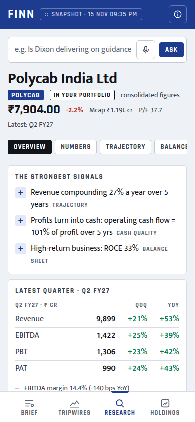
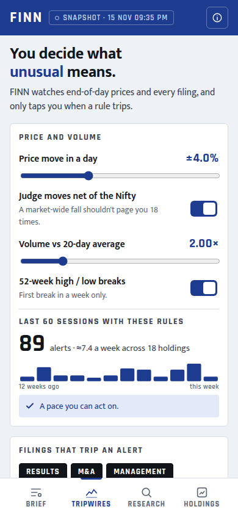
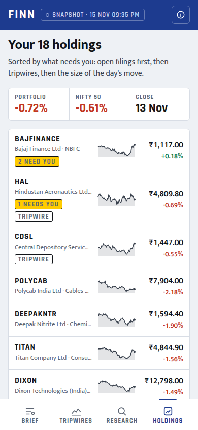

# FINN: Financial Investment Agent

A mobile-first agent for an Indian public-markets investor. **Push**: it tells you what changed across your portfolio and why it matters, with the routine paperwork filed away. **Pull**: it builds an analyst's first-hour dossier on any NSE company from primary sources only.

Built for the ENAM AI Engineer Build Challenge.

| Brief (push) | Research (pull) | Tripwires | Holdings |
|---|---|---|---|
|  |  |  |  |

---

## Try it

**Phone, no install (snapshot mode).** `web/` is a static app. Host it anywhere (GitHub Pages, Netlify, `python -m http.server`) and it reads the real data frozen in `web/data/` (taken 15 Nov 2026, 21:08 IST).

**Live mode (polls filings, pushes new material ones to the open app):**

```bash
python -m venv .venv && . .venv/bin/activate
pip install -r requirements.txt
uvicorn finn.server:app --port 8000          # open http://localhost:8000 on your phone/laptop
```

Optional model tiers: `export ANTHROPIC_API_KEY=...` (Haiku 5.5 for extraction, Opus 5.5 for verdicts), or `export FINN_OLLAMA_MODEL=qwen2.5:3b` for a free local model (low-stakes tasks only, see below). With neither, FINN runs entirely on its rules tier at zero cost.

Refresh the static snapshot: `python scripts/build_snapshot.py [EXTRA SYMBOLS…]`.
Deploy live: `render.yaml` (Render free tier, Docker) or any container host via `Dockerfile`.

---

## What it does

### Push: the Brief
- **Windowed digest.** Default last 24 hours; 3 days, 7 days, 30 days, "since your last visit", or any custom range. Every filing across the 18 holdings is classified and tiered:
  - **Needs you**: results, real M&A, top-management change, equity raises, rating downgrades, pledges.
  - **Worth a glance**: order wins, concall transcripts, divisional appointments, exchange clarifications.
  - **Handled**: investor-meet notices, newspaper copies, ESOP allotments, registrar housekeeping. Collapsed, grouped, still one tap away.
- **Judgment is visible.** Each card states why it surfaced, and sizes any rupee amount against the company's market cap: "₹1.6 lakh penalty, immaterial vs ₹13.1L cr market cap"; "₹5.8k cr ≈ 0.8% of market cap".
- **Quarterly results** get Revenue, EBITDA, PBT and PAT, QoQ and YoY, plus a read: "growth accelerating", "margin compressed 648 bps". Lenders get **net interest income** instead of EBITDA, because EBITDA means nothing when interest is the raw material.
- **Management change** gets the incoming person's profile, read from the filing's own SEBI-mandated *brief profile* annexure (education, experience, previous role), plus a LinkedIn people-search link. With a model key, a web lookup fills in when the filing carries no profile.
- **Price reaction** on every card: the next session's move, net of the Nifty, and volume vs its 20-day average.
- **Swipe right (or Done) to clear.** The station board's count flips down as you clear.

### Push: Tripwires
Configurable rules on end-of-day data: price move ≥ X% (optionally **net of the Nifty**, so a market-wide fall doesn't page you 18 times), volume ≥ Y × the 20-day average, first 52-week high/low break in a week, and which filing categories alert. A **noise meter** replays the rules over the last 60 sessions ("89 alerts, ≈7.4 a week") so you set thresholds from evidence. Every tripped move is linked to the filing that likely explains it. In live mode, new material filings arrive over Server-Sent Events as in-app toasts and optional browser notifications.

### Pull: Research
Ask in words ("Is KPIT delivering on its guidance?", "Asian Paints cash quality") or tap a symbol. Works for **any NSE symbol screener.in covers**, not only the demo set (tested cold on INFY and KAYNES: about 5 s each). Lenses:

| Lens | What it computes |
|---|---|
| Overview | The three strongest signals across all lenses, the latest quarter, the promise scorecard |
| Numbers | TTM revenue, margins, PAT, ROCE, ROE, D/E, P/E, P/B, yield, 52-week position |
| Trajectory | 3y/5y CAGRs, revenue vs PAT (operating leverage), margin drift in bps, quarterly YoY momentum |
| Balance sheet | Borrowings vs net worth, D/E trend, debtor/inventory/payable days, cash conversion cycle, CWIP, shareholding |
| Cash quality | CFO ÷ PAT over 5 years, FCF history and yield (marked not meaningful for lenders) |
| **Promise vs delivery** | Management's own quantified guidance from the last four concall transcripts, checked against the quarters reported **after** each call: delivered / beat / missed / pending / long-dated, plus guidance raised or cut across calls |
| Bull / bear | The strongest positive and negative signals, each anchored on a number |
| Business | Company profile, segment mix (model tier), management's opening remarks |

Primary sources only: filed financials, annual reports, concall transcripts. No news, no broker notes, no model outside knowledge.

---

## Design: the platform board

A PM between meetings needs a count, a ranked stack and a thumb, not a chat window. FINN's visual world borrows from Indian Railways' station-name boards and coach reservation charts, a system every Indian investor reads without thinking:

- **The board.** A chrome-yellow plate with a black keyline carries the brief's headline, "3 NEED YOU". Yellow means *needs you* and nothing else; when nothing does, the board turns white ("ALL QUIET"). As you clear cards, the count flips down like a split-flap display.
- **Reservation-chart rows.** Every filing card and every tripped alert carries a left time column (date and time, or "close"), the ticker in a coach-blue stamp, and figures on a shared grid.
- **A five-step materiality ramp.** The score drives stamp weight, headline size and time-column tint, so emphasis is computed, not styled by hand.
- **Colour discipline.** Green and red appear only on numeric deltas; positive and negative signals, promise outcomes and advice use coach blue and ink.
- **Type.** Rajdhani (Indian Type Foundry; squared, tracked caps) for the board, stamps and tier heads; Mukta (Ek Type, Mumbai) with tabular figures for reading and every number.

The system is recorded in [DESIGN.md](DESIGN.md); product context is in [PRODUCT.md](PRODUCT.md). The UI was built with the Impeccable design skill: a product interview, a direction roll with alternatives, two inspection rounds, and an independent review against the direction contract.

---

## Architecture

```
finn/
  sources/   http.py (polite, cached)  screener.py  nse_rss.py  prices.py (yfinance)  pdf.py
  engine/    classify.py  digest.py  results.py  people.py  alerts.py  research.py  guidance.py  enrich.py
  llm.py     model router: tiers, cache, cost ledger
  store.py   one SQLite file: HTTP cache, derived artefacts, filing ledger, model-call ledger
  server.py  FastAPI: /api/* + static app + SSE push + background poller
web/         index.html, assets/{styles.css, app.js}, data/ (snapshot)
scripts/     build_snapshot.py, smoke_sources.py
```

**Data sources and how they're reached**
- Filings: NSE's public "Latest Announcements" RSS (live, every listed company, mapped to holdings by the symbol in the attachment URL), plus BSE announcements via screener.in. Exchange PDFs are read directly.
- Prices: Yahoo Finance end-of-day via `yfinance`, one batched call.
- Fundamentals: screener.in's standardised tables, plus links to annual reports and concall transcripts (BSE / company PDFs).
- NSE's and BSE's JSON APIs refuse automated clients. FINN does not try to get past that; it uses the public feeds instead.

### Model routing: rules first, models only where judgment needs them

| Tier | Job | Model | Cost |
|---|---|---|---|
| rules | Classify every filing, score materiality, compute every number, evaluate alerts, retrieve guidance candidates, check promises against actuals | none | ₹0 |
| extract | Filing PDF → JSON (scans included), one-line filing summaries, classify guidance sentences, condense bios | `claude-haiku-5-5` (or local Ollama for low-stakes tasks) | ~$0.0001 per filing |
| reason | Promise-vs-delivery verdict, dossier narrative, bull/bear, bio web lookup | `claude-opus-5-5` at low effort | a few cents per dossier, once |

- **Shrink before you send.** A 50,000-character transcript becomes ~20 numbered candidate sentences (management speakers only, analysts and the moderator dropped), about 5% of the tokens.
- **Models never do arithmetic.** Outcomes (delivered / missed) are computed in Python from reported quarters; the model only classifies sentences and writes from verified facts.
- **Cached forever.** Every response is stored under `sha256(task, model, prompt)`, so a filing or transcript is paid for once; restarts are free.
- **Measured spend.** Every call goes to a ledger with tokens and dollars, shown in the app's info sheet.
- **Tested routing decision.** A local 3B model (qwen2.5:3b via Ollama) rejected KPIT's explicit "EBITDA 22–24%" guidance and invented figures in a narrative, so judgment tasks are gated to the hosted tier and the local model handles only one-line summaries.

---

## Judgment calls worth knowing about

- Maruti's filing of **Suzuki's** results is the parent's numbers, so it is context, not "Results".
- "5.74 crore warrants" is a share count, not ₹5.74 crore; amounts need a currency marker.
- A CEO of HAL's *Helicopter Complex* is a divisional change, not group leadership; a re-appointment is continuity.
- A rating *reaffirmation* or *withdrawal* is routine; a downgrade jumps to the top.
- Infosys guides revenue in **constant currency**; comparing it with rupee-reported growth would flatter them, so FINN marks it not comparable instead of "beat".
- Segment-level promises (Polycab's FMEG margins) are tracked but never "verified" against consolidated numbers.
- ITC holds no earnings calls, so there is no guidance to audit, and FINN says so instead of inventing one.

## Limits

- Filing history in snapshot mode is the last 30 days: screener's 5 most recent announcements per company plus what the NSE feed showed. The live server accumulates history as it polls.
- The hosted-model path follows the Anthropic SDK docs but was not exercised against the live API in this build environment (no key available); every model call degrades to the rules tier on failure. The local-model path was run end to end.
- Prices are end-of-day; there is no intraday feed.
